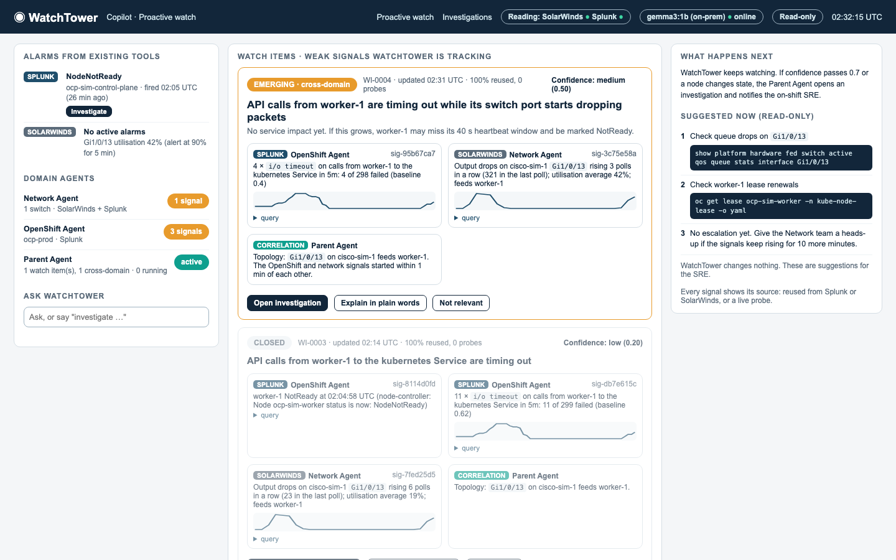
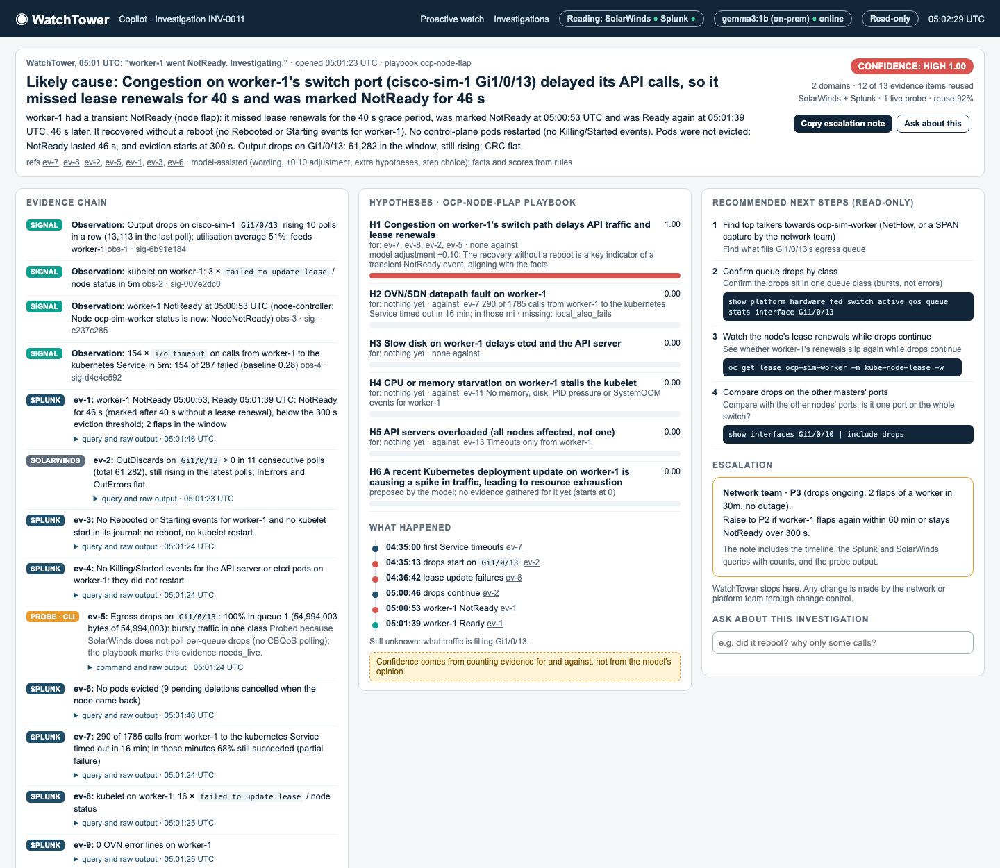

# WatchTower

An AI operations copilot that sits **above SolarWinds and Splunk** for a 24/7 monitoring team.
Domain agents (Cisco, OpenShift) watch the existing tools for weak signals and gather evidence; a
Parent Agent connects them by topology and time, opens investigations and scores hypotheses; the
Copilot explains the likely cause with its evidence, recommends read-only next steps and the right
escalation. WatchTower is **read-only**: it stops at Observe → Detect → Diagnose → Recommend.

This repository is the Builders Day proof of concept. It runs on an 8 GB MacBook Air M2 against a
lab of stand-ins, built around one real incident: an OpenShift node's calls to the kubernetes
Service time out on a congested switch port, the node flaps NotReady and recovers without a reboot.



## What it does

| Mode | What happens |
|---|---|
| **Proactive watch** | While Splunk and SolarWinds stay below every threshold, the OpenShift Agent sees Service timeouts from worker-1 (Splunk) and the Network Agent sees output drops rising on its switch port Gi1/0/13 (SolarWinds). The Parent Agent links them through `contracts/topology.yaml` into a cross-domain watch item, 100% reused data, no probes. |
| **Incident investigation** | worker-1 goes NotReady for about 30 s; Splunk alerts. WatchTower investigates (by itself, or when the SRE presses Investigate): 13 evidence items, 12 of them reused from Splunk and SolarWinds plus one read-only switch probe; likely cause "congestion on worker-1's switch port", high confidence; "recovered without a reboot, no evictions"; four read-only next steps; escalate to the Network team at P3, with a copyable note. |
| **Ask** | Questions answered only from stored investigations and watch items, citing evidence ids; anything else gets "I don't have evidence for that." |



## Quick start (lite profile, 8 GB Mac)

Requirements: OrbStack (or Docker Desktop), `brew install kind kubectl jq ollama uv`, then
`ollama pull gemma3:1b` (and `gemma3:4b` for `make eval`). Everything runs offline once images and
models are pulled.

```sh
make lab-up            # kind "ocp-sim": 1 master + 1 worker, svc-prober, demo app, read-only RBAC
make up                # Cisco sim, splunk-sim, solarwinds-sim, forwarder, Redis, agents, Copilot
make health            # ends "health OK"
open http://localhost:8080
```

`WT_LLM=off make up` runs without the model: detection, ranking and the evidence chain are rules;
only the plain-words wording uses the model. `make stop` stops the containers and keeps their data;
`make down && make lab-down` removes everything. Keep the Mac awake and on power while the lab runs.

## The demo

```sh
make demo                     # full storyline (~15 min), narrated, checked and recorded
make demo MODE=investigate    # short: the flap at ~3 min, incident investigation only
make fault / make clear       # or drive the fault yourself and watch the Copilot
```

`make demo` waits for any open watch item from an earlier run to close, records the run to
`demo/recordings/<name>`, and prints a check for every point of the definition of done:
proactive watch item within 6 minutes with the existing tools quiet and the node still Ready;
after the flap, Investigate on the Splunk alert gives the report within 3 minutes with the right
cause, "no reboot", at least three read-only next steps, Network team P3, at least 85% reuse and
at most one probe.

**Replay** (no lab, no model): `make stop && make replay NAME=rehearsal [SPEED=10]` replays a
recording into a fresh Redis and serves the same Copilot screens at http://localhost:8080 on the
recording's clock. `SPEED=0` jumps to the end. `make replay-list` lists recordings.

## Checks

| Command | What it checks | Lab |
|---|---|---|
| `make test` | 160+ tests on recorded fixtures | no |
| `make verify-investigation` | Recorded incidents and variants, LLM off and on (worst-case −0.10) | no |
| `make eval [MODEL=gemma3:4b] [BASE_URL=…] [API_KEY=…]` | The six LLM jobs on any OpenAI-compatible endpoint | no |
| `make health` | Everything up, no fault left on, memory within budget | yes |
| `make verify-sources` | Every SPL and SWQL template in `contracts/sources.yaml` returns data | yes |
| `make verify-watch` | Phase A of the fault raises both watch signals within 5 minutes, no probes | yes |
| `make verify-flap` | NotReady then Ready, no reboot, no evictions, no alerts in phase A | yes |
| `make verify-copilot` | The definition of done, through the Copilot; saves screenshots | yes |

## How good is the model? (`make eval`)

Scored on recorded runs (7 investigation cases, 12 job cases), October 2026, on the 8 GB M2 Air
with the lab stopped. Full tables in `eval/results/`.

| | gemma3:4b | gemma3:1b (lite demo model) |
|---|---|---|
| Valid JSON on the first try | 100% | 100% |
| Citation accuracy (Ask) | 86% | 57% |
| Top hypothesis right (rules alone: 100%) | 100% | 100% |
| Confidence band right | 100% | 100% |
| Evidence interpretation right | 2 of 4 | 1 of 4 |
| Latency p50 / p95 | 17 s / 27 s | 4.6 s / 8.2 s |

The ranking comes from the rules, so it holds with either model or none; the model adds
wording, extra hypotheses and step choice. gemma3:1b moved every confidence up by +0.10 regardless
of the evidence (the cap keeps that harmless); gemma3:4b used its adjustment once, downwards, when
the probe was missing. Score the on-prem Gemma the same way:
`make eval MODEL=<name> BASE_URL=https://gemma.example/v1 API_KEY=…`.

## What is simulated, what is real

| In production | In this PoC | Notes |
|---|---|---|
| OpenShift (3 masters + workers) | kind `ocp-sim`, upstream Kubernetes 1.37 | Lite: 1 master + 1 worker; full (16 GB): 3 + 1. Grace period pinned to OpenShift's 40 s. No OVN, Routes or ClusterOperators. |
| Component logs showing `dial tcp 172.30.0.1:443: i/o timeout` | `svc-prober` DaemonSet: one call a second to the Service VIP, 1 s timeout | Same error wording as the Go clients. kind's VIP is 10.96.0.1. |
| Cisco Catalyst switches | `cisco-sim-1` (and `-2`): IOS-XE style SSH CLI, SNMPv2c IF-MIB, syslog, fault API | Congestion = output drops in one egress queue, CRC flat, ~46% average utilisation. |
| Splunk + Universal Forwarders / Splunk OTel | `splunk-sim` (HEC, export search with an SPL subset, saved-search alerts) + `forwarder` | Same REST paths and response shapes as Splunk Enterprise. |
| SolarWinds NPM | `solarwinds-sim` (SNMP poller every 60 s, SWIS JSON API with a SWQL subset, alert rules) | Same SWIS path and JSON shape. |
| On-prem Gemma (~40B) | `gemma3:1b` (lite) / `gemma3:4b` in Ollama on the Mac | Any OpenAI-compatible endpoint works. |
| **Real code, no simulation** | Domain agents, Parent Agent, playbooks, LLM jobs, Copilot, adapters | `wt/` talks to the stand-ins only through the real tools' API shapes. |

## Pointing WatchTower at the real tools

WatchTower reads its endpoints from the environment (`wt/common/config.py`); nothing in `wt/`
knows it is talking to a stand-in.

| Variable | Real value |
|---|---|
| `WT_SPLUNK_URL`, `WT_SPLUNK_TOKEN` | `https://splunk.example:8089`, a read-only search token (role with `search` on the OpenShift and network indexes) |
| `WT_SOLARWINDS_URL`, `WT_SOLARWINDS_USER`, `WT_SOLARWINDS_PASSWORD` | `https://orion.example:17778`, a read-only Orion account |
| `WT_VERIFY_TLS` | `on` |
| `WT_KUBECONFIG` | a kubeconfig for a service account bound to a get/list/watch ClusterRole (see `lab/k8s/rbac.yaml`) |
| `WT_SSH_USER`, `WT_SSH_PASSWORD` | a switch account limited to privilege-1 `show` commands (the CLI adapter also refuses anything but `show`) |
| `WT_LLM_BASE_URL`, `WT_MODEL`, `WT_LLM_API_KEY` | the on-prem Gemma's OpenAI-compatible endpoint |

Then adjust the rulebooks, not the code:
- `contracts/sources.yaml`: index and sourcetype names in every SPL template (production uses
  the components' own logs, see each signal's `prod_query`), and the SWQL templates if your Orion
  uses different interface naming.
- `contracts/topology.yaml`: which switch port feeds which node (generate from CDP/LLDP and the CMDB).
- `contracts/escalation.yaml`: your teams and priority rules.
- `wt/agents/*/rules.yaml`: watch thresholds once you have real baselines.
Before trusting it, run `make verify-sources`-style checks of every template against the real
tools, and `make eval BASE_URL=… MODEL=…` against the on-prem model.

## Layout

```
wt/common/        contracts (Pydantic), bus (Redis streams), LLM client and the six jobs, Splunk/SolarWinds
                  adapters, read-only probes (SSH show, Kubernetes GET), SQLite store, audit log
wt/agents/        network/, openshift/ (watch rules + evidence), parent/ (correlator, investigator, predicates)
wt/copilot/       FastAPI + Jinja2 + HTMX + Chart.js (vendored, no CDN)
wt/replay/        record and replay
sims/             cisco_sim, splunk_sim, solarwinds_sim, forwarder
lab/              kind configs, manifests, fault scripts, health and verify scripts
contracts/        schemas, sources (reuse-first rulebook), topology, escalation
playbooks/        ocp-node-flap, network-port-congestion
eval/             fixtures, recorded investigation cases and variants, LLM job cases, run_eval.py
demo/recordings/  recorded rehearsals for make replay
```

## Why these choices

- **kind with real API servers.** The incident needs real kubernetes-Service load balancing and
  node network degradation (`tc netem` in the kind node); kind nodes are containers on the M2.
- **Stand-ins with the real API shapes.** WatchTower's value is reusing what Splunk and SolarWinds
  already hold, so it queries them through SPL export search and SWIS/SWQL; moving to the real tools
  is configuration.
- **Simulators, not network VMs.** The M2 has no nested virtualisation, and simulators give
  repeatable faults.
- **Deterministic first, narrow LLM jobs.** Detection, correlation and confidence are rules; the
  model does six small jobs with JSON schemas, two few-shot examples, one retry, guards and a rule
  fallback, and may move confidence by at most ±0.10. The right cause ranks first with the model off.

The original build kit (master prompt, phase prompts, skills, wireframes) is still here:
`MASTER_PROMPT.md`, `prompts/`, `.claude/skills/`, `wireframes/`, `FEASIBILITY.md`.
