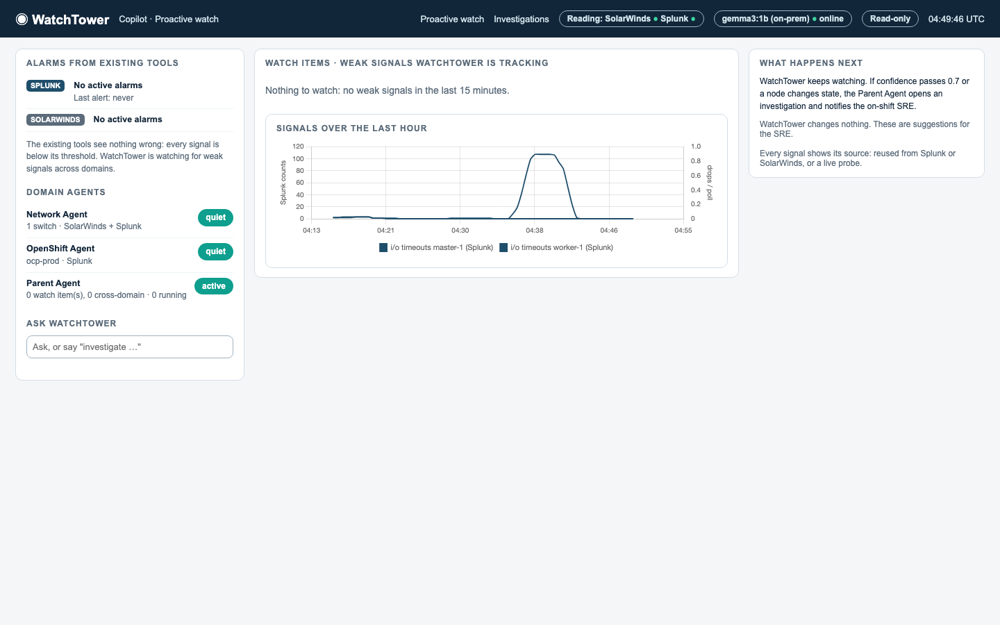
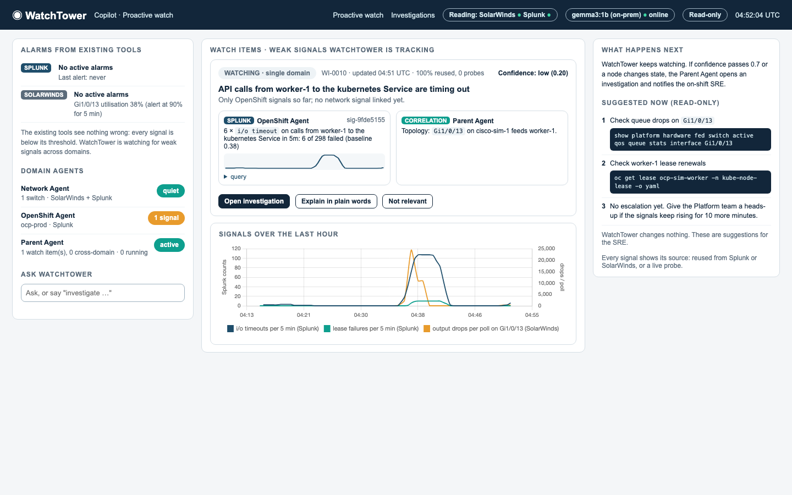
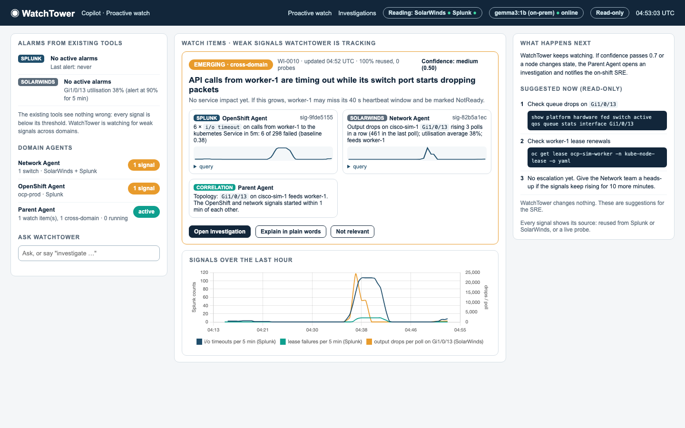
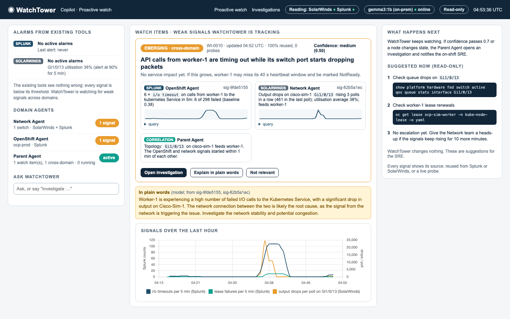
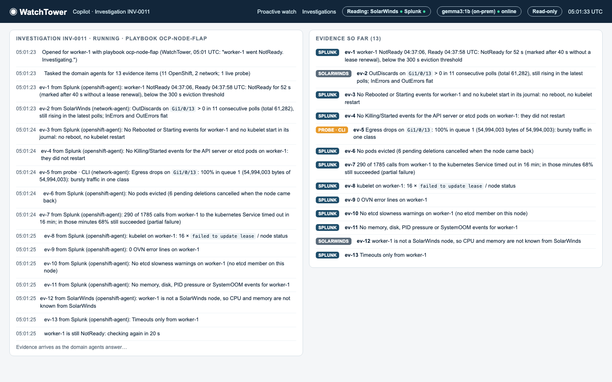
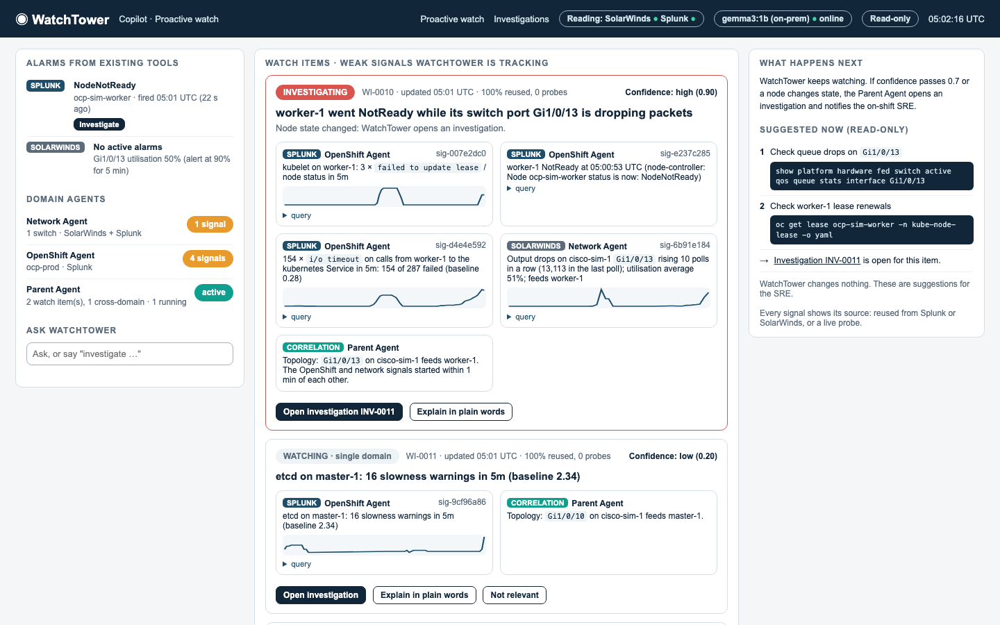
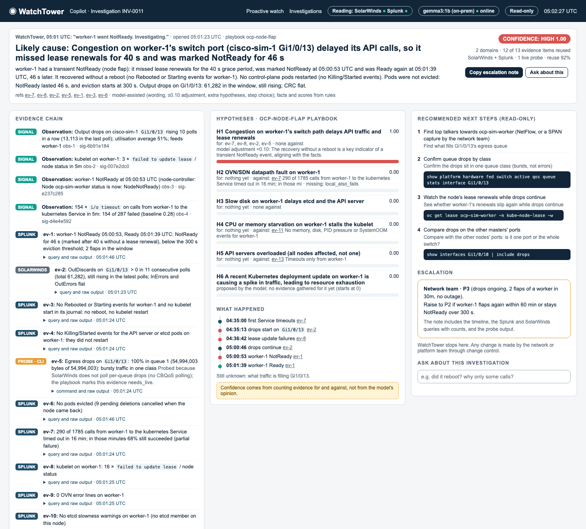
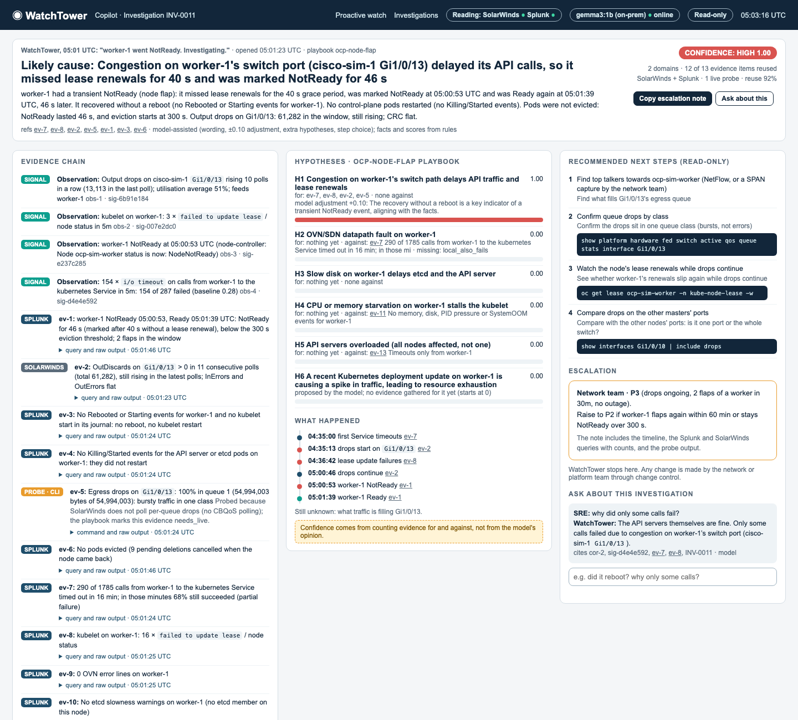
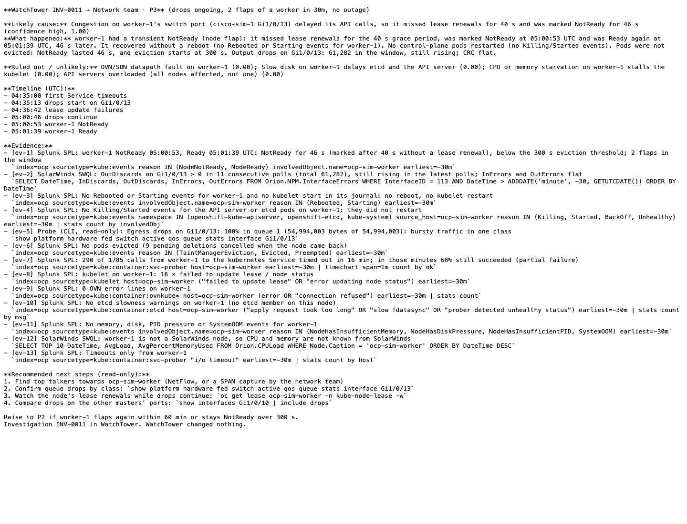
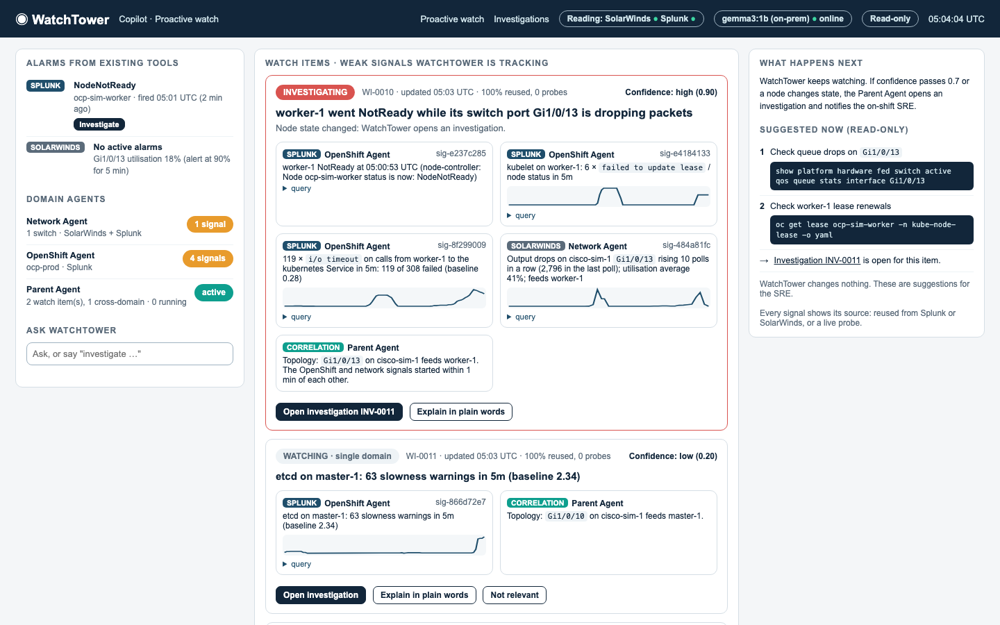

# WatchTower demo, stage by stage

Live run on the lite lab (8 GB MacBook Air), 2026-10-11 04:49 UTC: `make demo` (full storyline) with these screenshots taken as each stage happened (`lab/demo_screenshots.py`).
Fault phases (UTC): A 04:50:09, B 04:56:09, C 05:00:09, D 05:01:25, clear 05:02:35

## 00. Quiet baseline: no alarms in Splunk or SolarWinds, agents quiet, nothing to watch

_04:49:38 UTC_

## 01. First weak signal: a watch item at low confidence; the tools are still quiet

_04:51:57 UTC_

## 02. Cross-domain watch item: Service timeouts (Splunk) + drops on the switch port that feeds the node (SolarWinds), linked by topology; 100% reused, no probes

_04:52:55 UTC_

## 03. Explain in plain words (LLM job 1, from the signals only)

_04:53:04 UTC_

## 04. WatchTower opened an investigation on the state change by itself: tasks go to the domain agents, evidence arrives live

_05:01:32 UTC_

## 05. The node flapped: Splunk's NodeNotReady alert appears with an Investigate button; the watch item turns to INVESTIGATING

_05:02:12 UTC_

## 06. The report: likely cause, no reboot, evidence chain with sources, hypotheses, timeline, read-only next steps, escalation

_05:02:26 UTC_

## 07. Ask: answered only from the stored evidence, citing ids

_05:02:40 UTC_

## 08. Copy escalation note: the Markdown for the Network team's ticket

_05:02:44 UTC_

## 09. After the fault clears: the alert stays in Splunk, the item links to its investigation, the signals age out

_05:03:59 UTC_

